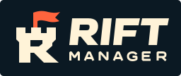

# Rift Manager identity

The tower doubles as the initial **R**. Its orange pennant stays visible over both teams’ colors, so the game keeps its own identity when the clubs swap sides. The stacked **RIFT MANAGER** lettering is drawn in the SVG and requires no installed font.

| Placement | Artwork |
| --- | --- |
| Game title, dark header, share graphics | [Cream wordmark on transparent](../public/brand/rift-manager.svg) |
| Paper and other light backgrounds | [Ink wordmark on transparent](../public/brand/rift-manager-ink.svg) |
| README or an unknown background | [Wordmark on ink](../public/brand/rift-signature.svg) |
| Browser tab or small avatar | [Square tower mark](../public/brand/rift-mark.svg) |
| iOS home screen | [180 × 180 icon](../public/brand/apple-touch-icon.png) |
| Links and embeds | [1200 × 630 cover](../public/rift-manager-social-v3.png) |

Use the full name for introductions. Switch to the tower when the name is already present or the wordmark would be narrower than 110 pixels. Leave at least the width of one battlement around the artwork. On photography, give the cream letters a dark area to sit on. Ink is `#0B1923`, cream is `#FFF3D8`, and the pennant is `#FF643D`. The light-background version uses a deeper orange, `#C83E20`.

Edit [the master SVG](../public/brand/rift-manager.svg), then run `npm run brand:render`. The command rebuilds the light and dark signatures, square mark, home-screen icon and social card. Commit those files together. The [social preview notes](SOCIAL-PREVIEW.md) cover the versioned share URL and artwork source.

## Club marks

Club crests are separate from the game identity above. They are original marks drawn for this game, not official team or league logos.

`TeamCrest` draws every club from one shield: a monogram in white on the club colour, a half-shade on the right and a thin inner highlight. The current ten LCK clubs (T1, GEN, HLE, DK, KT, DRX, KDF, FOX, BRO, NS) use the Broadcast Night monogram crests with their curated colours. We chose those over the earlier glyph paths because the monogram holds at 24 px, where the glyphs blur into a coloured shield, and because every other club can then share the same language instead of looking like a stand-in. The `crest-*.svg` files under `docs/design/broadcast-night/assets/` stay as the design reference; the app draws the same shield in code, so nothing extra loads.

Every other club (other leagues, historical seasons, campaign teams) uses the same shield. The colour is `teamMeta.color` when the club has one, otherwise a hash of its id that never changes. The monogram comes from `short`, or from the id when no short is known. A motif, one of band, stripes, chevron, tower or canton, is picked from the id so clubs with the same initials still differ. The shield fill is darkened until the white monogram reaches 3.6:1, and the rim is lightened where the club colour sits close to `--bg` (DK `#002fa7`).

Screens pass `teamId` (and `name`). Pass `label` only when the crest is the one thing naming the team; otherwise it is hidden from assistive technology. To preview every club, run `node scripts/crest-sheet.mjs`; it writes a contact sheet at 24, 48 and 96 px on `--bg` and `--s2`.
